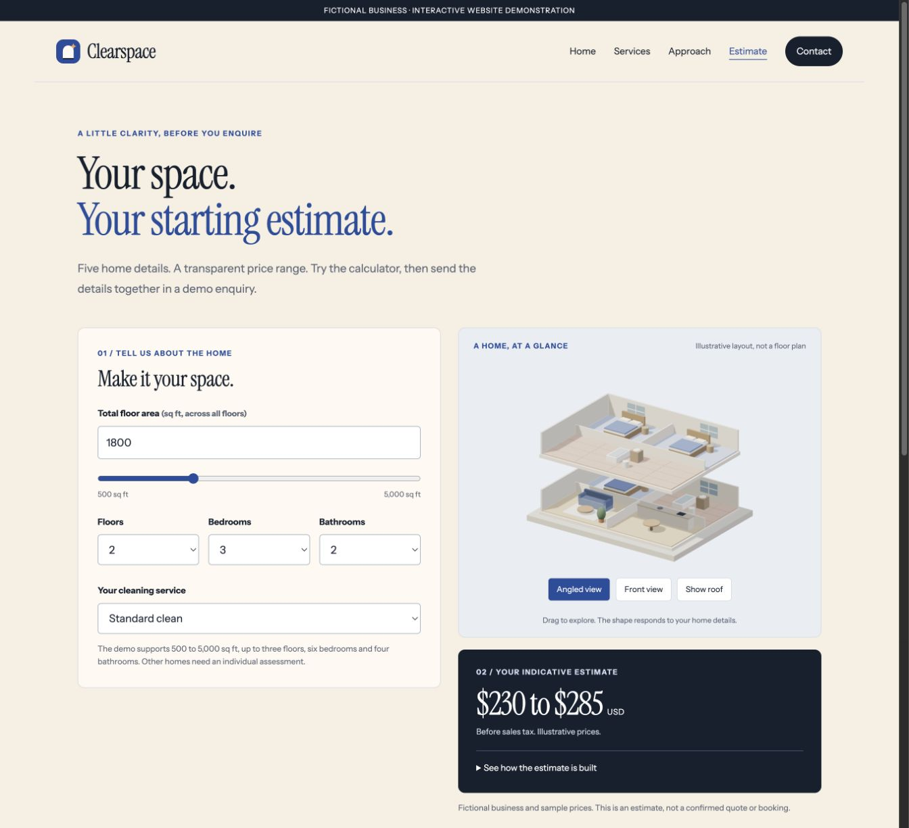

# Cleaning estimate calculator

A small, configurable JavaScript estimate engine used in the Clearspace cleaning-business website concept.

[Try the complete live website](https://clearspace-cleaning-demo.pages.dev/) · [View my Upwork profile](https://www.upwork.com/freelancers/~016f60ebc0752c6858)



## What it demonstrates

A customer chooses the home size, floors, bedrooms, bathrooms and cleaning service. The calculator builds a line-by-line estimate, applies the minimum visit value, and presents an indicative range. The full website carries the selected details into a working test enquiry with a saved receipt.

Clearspace is a fictional business. Prices are sample values in USD before sales tax. The example is an estimate, not a binding quote or booking.

## Run the code

Requires Node.js 22 or later. There are no package dependencies.

```sh
npm start
npm test
```

The sample home produces a base value of $257 and an indicative range of $230 to $285. Calculation uses integer cents and validates the selected limits and service.

## Files

- `src/config.mjs`: sample branding, service rates, minimums, allowed inputs and default home.
- `src/quote.mjs`: configuration validation, estimate calculation, currency formatting and enquiry summary.
- `example.mjs`: a runnable example using the default home.
- `tests/quote.test.mjs`: known-value calculations, minimum visits, invalid inputs, configuration checks and demo labelling.

This repository presents the calculation core. The complete live site also contains the responsive website, interactive scene and private test-enquiry flow.

## My role

I shaped the offer, customer journey and visual direction, then developed and reviewed the implementation with AI assistance. I take responsibility for scope, integration, testing and handover. This is independent demonstration work, with no claimed client results.
